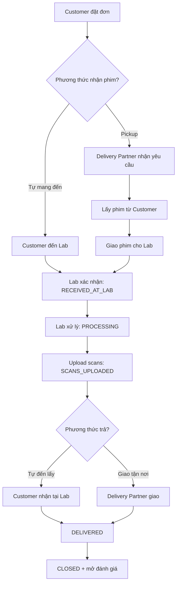
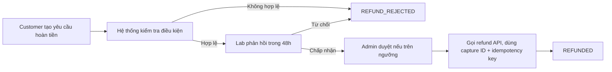
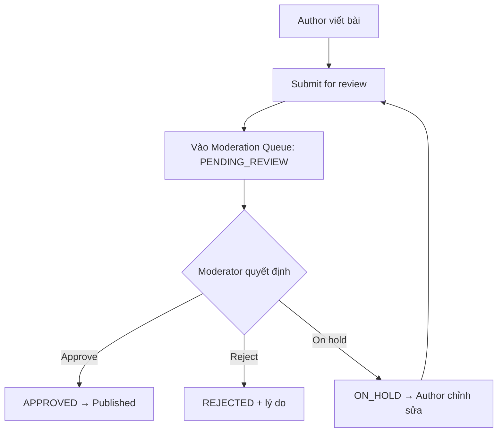

# Tổng Quan Tài Liệu Yêu Cầu - Issue #10

## 1. Mục tiêu
Tài liệu này hệ thống hóa toàn bộ quy trình nghiệp vụ cho hệ thống Film Lab, phục vụ thiết kế API và Cơ sở dữ liệu.

## 2. Phạm vi thực hiện
Quy trình Nhận phim & Giao hàng (`01-nhan-phim-va-giao-hang.md`)
Quy trình Thanh toán & Hoàn tiền (`02-thanh-toan-va-hoan-tien.md`)
Quy trình Chia sẻ kiến thức & Cộng đồng (`03-kien-thuc-va-cong-dong.md`)
Marketplace:
# Quy Trình Nhận Phim & Giao Hàng

## 1. Mục tiêu & Phạm vi
Quản lý toàn bộ vòng đời của đơn hàng từ lúc khách đặt đơn, giao phim cho Lab, Lab xử lý tráng/scan, đến khi giao lại sản phẩm hoàn tất.

## 2. Sơ đồ luồng (Mermaid)

## 3. Trạng thái & Sự kiện

| Trạng thái | Ý nghĩa | Hành động kích hoạt | Vai trò thao tác |
|---|---|---|---|
| `PENDING_PICKUP` | Đã đặt đơn, chờ lấy phim | Khách chọn pickup | Customer |
| `PICKED_UP` | Đối tác đã lấy phim từ khách | Đối tác xác nhận | Delivery Partner |
| `RECEIVED_AT_LAB` | Lab đã nhận phim | Lab quét mã / xác nhận | Film Lab |
| `PROCESSING` | Đang xử lý (rửa/scan) | Lab bắt đầu công đoạn | Film Lab |
| `SCANS_UPLOADED` | File scan đã upload | Lab upload xong | Film Lab |
| `READY_FOR_DELIVERY` | Phim gốc/ảnh sẵn sàng trả | Lab hoàn tất kiểm tra | Film Lab |
| `DELIVERED` | Đã giao cho khách | Khách/đối tác xác nhận | Delivery Partner / Customer |
| `CLOSED` | Đơn kết thúc | Hệ thống tự động | System |

## 4. API đề xuất

| Method | Endpoint | Mục đích | Quyền |
|---|---|---|---|
| `POST` | `/orders` | Tạo đơn mới | Customer |
| `PATCH` | `/orders/{id}/status` | Cập nhật trạng thái | Lab / Partner |
| `POST` | `/orders/{id}/scans` | Upload file scan | Film Lab |
| `GET` | `/orders/{id}/tracking` | Truy vấn trạng thái realtime | Customer / Lab |

## 5. Thực thể dữ liệu
- **Order**: `id`, `customer_id`, `lab_id`, `status`, `pickup_method`, `delivery_method`.
- **FilmRoll**: `id`, `order_id`, `film_type`, `quantity`.
- **ScanFile**: `id`, `order_id`, `file_url`, `created_at`.
- # Quy Trình Thanh Toán & Hoàn Tiền

## 1. Mục tiêu & Phạm vi
Đặc tả phương thức thanh toán online/COD và quy trình hoàn tiền an toàn (chống rủi ro giao dịch lặp).

## 2. Phương thức thanh toán & Trạng thái

| Phương thức | Trường hợp áp dụng | Trạng thái chuyển đổi |
|---|---|---|
| Online (VNPay/Momo/Thẻ) | Thanh toán khi đặt đơn | `PENDING` → `PAID` / `FAILED` |
| Tại Lab | Trả tiền khi đến nhận | `UNPAID` → `PAID` |
| COD (Thu hộ) | Trả khi giao hàng | `COD_PENDING` → `COD_COLLECTED` |

## 3. Sơ đồ luồng hoàn tiền (Mermaid)

## 4. Thiết kế API Hoàn tiền
- **Endpoint:** `POST /payments/{paymentId}/refunds`
- **Header bắt buộc:** `Idempotency-Key: <uuid>`
- **Ghi chú kỹ thuật:**
  1. Bắt buộc lưu `capture_id` của giao dịch gốc để đối soát.
  2. Bắt buộc truyền `Idempotency-Key` để chống gửi trùng yêu cầu hoàn tiền.
  3. Phải kiểm tra hạn mức hoàn tiền không vượt quá số tiền đã thanh toán.
  4. # Quy Trình Chia Sẻ Kiến Thức & Cộng Đồng

## 1. Mục tiêu & Phạm vi
Quản lý luồng đăng bài viết chia sẻ kiến thức nhiếp ảnh và quy trình kiểm duyệt nội dung (Moderation Queue).

## 2. Trạng thái kiểm duyệt

| Trạng thái | Ý nghĩa |
|---|---|
| `DRAFT` | Tác giả đang soạn bài |
| `PENDING_REVIEW` | Đã gửi, đang chờ duyệt |
| `APPROVED` | Đã duyệt, bài viết hiển thị công khai |
| `REJECTED` | Bị từ chối (kèm lý do) |
| `ON_HOLD` | Tạm giữ, yêu cầu tác giả chỉnh sửa |

## 3. Sơ đồ kiểm duyệt bài viết (Mermaid)

## 4. Phân quyền người dùng
- **Photography Expert / Author:** Được tạo và chỉnh sửa bài viết.
- **Moderator / Admin:** Phê duyệt/từ chối bài viết trong Hàng đợi kiểm duyệt (`Moderation Queue`).
- **User thường:** Chỉ được xem các bài viết ở trạng thái `APPROVED`.
